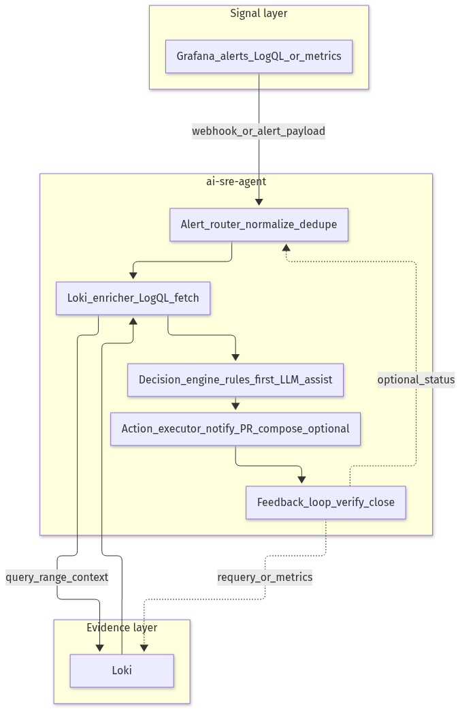
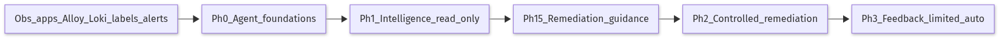
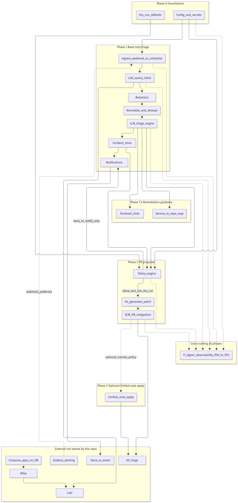
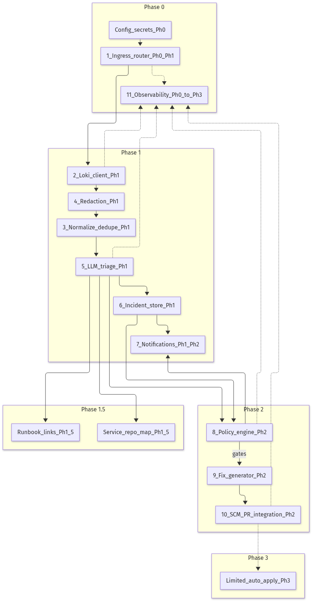
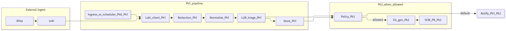
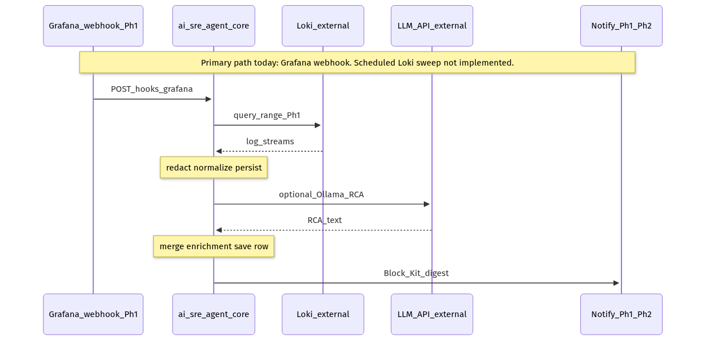
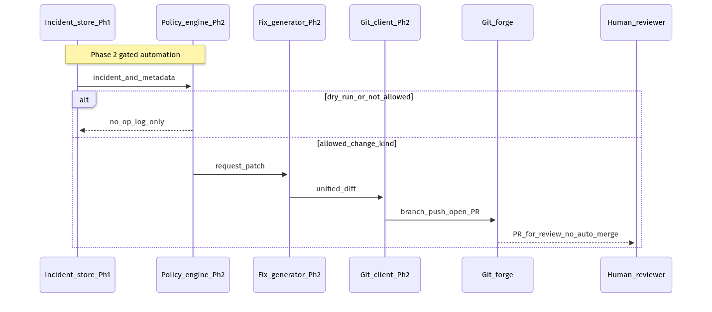
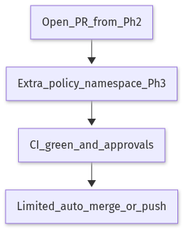
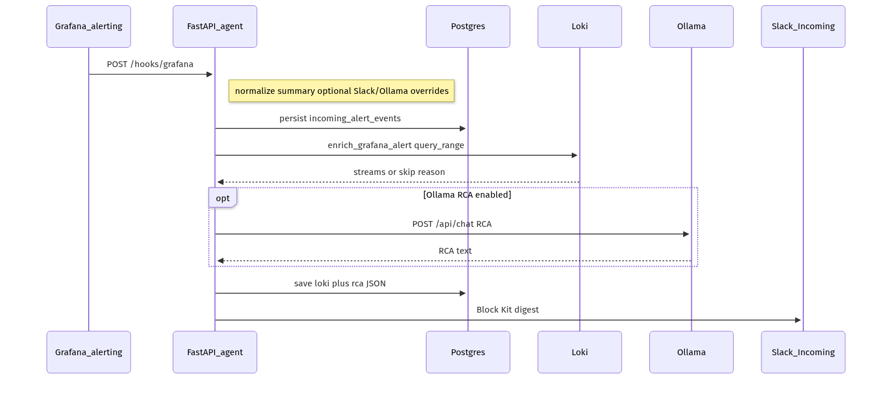

# ai-sre-agent — architecture

This document describes **ai-sre-agent**: the **orchestrator** is **VM + Docker Compose** friendly; **Loki / Grafana / Alloy** are assumed to **already run in production on dedicated hardware** (see [Rollout plan](#rollout-plan-cpu-first-single-vm-gpu-self-host-deferred)). **Kubernetes is not assumed** for the agent.

**First-time deploy (CI, runners, env/secrets, Grafana webhook):** use **[README.md](README.md)** (*Start here*, *Deploy — `deploy-agent`*, *Grafana webhook setup*). **Ollama** is deployed from the sibling **`ai-model`** repo.

You are not building “another log viewer.” You are building an **incident decision system**: **Grafana (alerting)** defines *what matters*, **Loki** holds *evidence*, and this service is the **router + enricher + decision support + optional executor**.

## Goals and non-goals

**Goals**

- Turn alerts and/or log slices into **deduplicated incidents** with **evidence** and **actionable** next steps.
- Prefer **alert-driven** triggers (webhook) and use **Loki** for context via LogQL; optional **scheduled Loki scans** as a safety net where alert coverage is thin.
- Keep a **human in the loop** until policy explicitly allows more automation.
- Be **auditable**: every suggestion or PR can be traced to alert payload, Loki query parameters, samples, and model version (today: Postgres row + stored JSON + app logs; structured audit log and rate limits remain backlog—see root README TO_DO).

**Non-goals (initially)**

- Fully autonomous remediation and auto-merge without review.
- Replacing Grafana for dashboards or replacing Alloy as the log shipper.
- Being a general-purpose “personal agent” across unrelated tools (see [Alternatives considered](#alternatives-considered)).

## System context

- **Ingest (production observability plane)**: Apps → **Alloy** → **Loki** (source of truth for log lines). In the **current plan**, **Loki, Grafana, and collectors already run on dedicated production hardware**—this repo does **not** replace or re-host that stack.
- **Signal**: **Grafana Alerting** (LogQL and/or metric rules) → **webhook** (or compatible Alertmanager payload) → **ai-sre-agent** (separate deployment, reachable from Grafana’s network).
- **Evidence**: ai-sre-agent → **Loki** `query_range` / LogQL around the alert window (typically ±5–15 minutes, bounded), over the network to the **existing** Loki endpoint.
- **Humans**: Grafana Explore on the same Loki; Slack/email for notifications.
- **Code changes**: ai-sre-agent → **git forge** (branch + PR) when Phase 2 remediation is enabled.

**Why Loki API for logs**: stable, automatable contract (`/loki/api/v1/query_range`). **Why not “read logs from Grafana” as the primary path**: Grafana is the control plane and UI; log retrieval for automation should still be **Loki**.

Diagrams in [Architecture diagrams](#architecture-diagrams) are embedded as **PNG** so they render on Markdown hosts that do not support Mermaid. **Editable sources** live under [`docs/diagrams/mermaid/`](docs/diagrams/mermaid/).

## Rollout plan: CPU-first single VM (GPU self-host deferred)

**Operational reality:** one **CPU-only VM** (example: **16 vCPU / 32 GB / 250 GB** disk) typically runs **two Compose stacks** from **two repos**: **`ai-sre-agent`** (**FastAPI + Postgres**, **`deploy-agent`**, runner **`ai.agent`**) and **`ai-model`** (**Ollama**, **`deploy-ollama`**, runner **`ai.model`**). Same physical host, **different runner tags** so jobs do not collide.

**Self-hosted GPU vLLM** (repo **`ai-model`**, pipeline **`deploy-vllm`**, runner label **`common.ai`** on a **future GPU machine**) is **out of scope until that runner exists**. **Do not run `deploy-vllm` on the CPU VM**. When Ollama is not enough before GPU exists, **escalate to a vendor OpenAI-compatible API** via **`OPENAI_BASE_URL`** + **`OPENAI_API_KEY`** in **`ai-sre-agent`**.

**Observability (Loki, Grafana, Alloy) stays on existing production hardware**—the agent VM only needs stable **network access** to Loki (queries) and a **webhook ingress** Grafana can reach.

### VM sizing (agent host only — observability elsewhere)

Rough guidance for **FastAPI + Postgres (+ optional `pgvector`)** in **`ai-sre-agent`**, plus **Ollama** in a **separate Compose project** from **`ai-model`** on the **same CPU host** (default local LLM). **Do not** size this disk for Loki retention; production Loki lives on its own hardware.

| Profile | vCPU | RAM | Disk (agent VM) | Notes |
| --- | --- | --- | --- | --- |
| **Minimum** | 4 | **16 GB** | **~100 GB** | Tight: **Postgres + agent images** plus **Ollama model weights** (second compose) on the same box; **slow** CPU inference under load. |
| **Comfortable** | **8** | **32 GB** | **~200 GB** | Headroom for **Postgres**, **`pgvector`**, **Ollama** (separate stack), logs. Still **CPU-only**. |
| **Deployed (example)** | **16** | **32 GB** | **250 GB** | Runners **`ai.agent`** (**`deploy-agent`**) + **`ai.model`** (**`deploy-ollama`**) on same host; **`deploy-vllm`** targets **`common.ai`** on a **GPU host** when you add one—not this CPU box. |
| **Network** | — | — | — | Low-latency, reliable path to **prod Loki** (TLS); Grafana must be able to **POST webhooks** to the agent; align **firewall / allowlists** with the observability team. |

**Prod Loki** retention, cardinality, and disk are owned by the **observability stack**, not this VM.

Add **swap only as a last resort**; prefer enough RAM so **Ollama** (from **`ai-model`**) + **Postgres** do not thrash.

### Where the LLM runs (**this rollout: Ollama on CPU via `ai-model`; vendor API for escalation**)

**Default (now):** **Ollama** on the **same CPU VM** as the orchestrator, deployed from **`ai-model`** (**`deploy-ollama`**, runner **`ai.model`**); **`ai-sre-agent`** calls it over **`OLLAMA_HOST`** (e.g. **`http://ollama:11434`** on **`ai_model_ollama_default`**). Treat this as the **baseline** path.

**Escalation (when quality or patch generation needs a stronger model):** **Vendor OpenAI-compatible API** (e.g. **OpenAI**, Anthropic-compatible adapters, …) via **`OPENAI_BASE_URL`** + key in **`ai-sre-agent`** config—**no self-hosted GPU required** for this phase.

**Optional later:** **`ai-model`** **`deploy-vllm`** on a **GPU host** with runner tags **`self.hosted`**, **`linux.shell`**, **`common.ai`**—not on the CPU VM.

### Repositories (scope)

| Repo | Role |
| --- | --- |
| **`ai-sre-agent`** (this repo) | Webhook ingress, Loki client, dedupe, policy, prompts, incident store, notifications, optional git PR actions; **Compose: agent + Postgres** (runner **`ai.agent`**). |
| **`ai-model`** | **CPU (now):** **Ollama** via **`docker-compose.ollama.yml`** and pipeline **`deploy-ollama`** (runner **`ai.model`**). **GPU (later):** **vLLM** via **`docker-compose.yml`** and **`deploy-vllm`** (runner **`common.ai`** on a GPU machine). |
| **Production observability** | **Already deployed** on dedicated hardware (**Loki / Grafana / Alloy**). This project only needs **URLs, auth, and network access**; optional **`observability/`** folder here for **mirrored** alert/LogQL snippets aligned with prod—not a second copy of the stack. |

### Database and retrieval (Postgres-first)

Use **Postgres** from the start for the **incident store**, idempotency, and reporting ([incident store](#6-incident-store)). A single Postgres service in Compose next to the agent is **appropriate** for this project size.

**Vectors / better “context” for suggestions** (runbook snippets, past incidents, small internal docs—not raw Loki dumps):

- **Prefer [`pgvector`](https://github.com/pgvector/pgvector) in the same Postgres** when you want semantic retrieval: one DB to back up, one pool, simpler VM footprint. Chunk text, embed, store `vector`, **top‑k retrieve into prompts** (RAG-lite).
- A **dedicated vector database** (Qdrant, Weaviate, Milvus, etc.) is optional—consider it if Postgres + `pgvector` stops meeting **latency, scale, or isolation** needs.

**Redis** stays optional (queues, rate limits, hot cache)—add when you outgrow a single worker or need cross-process coordination.

### How the local model works (**no training on this VM**)

- **You do not train** the base model on the agent VM. Ollama runs a **pre-trained** checkpoint: it already has broad **language and general code** knowledge from its original training run.
- **What it does not magically know:** your **service names**, **on-call conventions**, **internal libraries**, or **“this alert always means X”** unless you put that in the **prompt**, **rules**, or **retrieved context** (Loki excerpts, runbooks, past incidents).
- **Inference** = each request: build a prompt (alert + bounded logs + optional snippets) → model **forward pass** → text/JSON out. Weights stay fixed unless you **pull a different Ollama model** or swap provider.

### Getting better over time (**past incidents ≠ weight training**)

Improvement is mostly **systems and data around** the model, not re-training weights on your logs:

| Lever | What it does |
| --- | --- |
| **Postgres incident store** | Same fingerprint again? Attach **last resolution**, **links**, **reviewer notes**—inject into prompt or rules. |
| **`pgvector` on past write-ups** | Embed **resolved incident summaries**, **runbook chunks**, **postmortems**; **retrieve top‑k** semantically similar to the current error → **RAG-lite** into the prompt. |
| **Rules / playbooks first** | Deterministic “if signature X then suggest Y” reduces bad LLM guesses and teaches consistency. |
| **Prompt versioning** | Treat prompts like code: **version**, measure, iterate when suggestions are weak. |
| **Human feedback** | Slack **accept/reject**, optional **tags** stored on the incident row for analytics and future prompt examples (**few-shot** lines in prompt, carefully curated). |
| **Better observability** | Cleaner **structured logs** and **alerts** improve the *input* to the same model more than any local “training.” |

**Fine-tuning** a foundation model on your logs is a **separate**, heavy **MLOps / governance** track—not required to get value. Revisit only if retrieval + prompts + rules plateau and the org accepts the cost and risk.

### First goal: **meaningful suggestions** for errors (minimum bar)

Ship these **before expecting the model alone to carry quality**:

1. **[Log and label contract](#log-and-label-contract-prerequisites-for-good-automation)** — structured lines + sane Loki labels so alerts and LogQL are meaningful.
2. **Alert → bounded Loki window** — evidence, not whole streams; **redaction** before any LLM call.
3. **Versioned prompt + JSON (or schema) output** — confidence, risk, “facts vs hypotheses” ([LLM triage](#5-llm-triage-engine-assist-not-sole-decider)).
4. **Rules first** — map known signatures to canned guidance so the LLM is not the only brain ([Policy engine](#8-policy-engine)).
5. **Incident store + Slack** — deduped thread with links back to Grafana/Loki ([Notifications](#7-notifications)).

**Optional “feed” beyond raw logs:** link **runbooks** / **service → repo** YAML into the prompt ([Phase 1.5](#phase-15-remediation-guidance-still-no-mutating-actions)); later, small **RAG** over internal docs if suggestions still feel shallow.

## Mental model: signal, evidence, brain

| Role | System | Responsibility |
| --- | --- | --- |
| **Signal** | Grafana alerts (LogQL / metrics) | Encode *incident-worthy* conditions; attach labels and annotations (including suggested LogQL). |
| **Evidence** | Loki | Store and query raw/semi-structured log lines and streams. |
| **Brain + automation** | ai-sre-agent | Normalize alerts, pull context from Loki, dedupe, apply **rules first**, use **LLM for assist only** (summarize, classify, suggest), then optional **actions** (notify, PR, limited Compose operations) under policy. |

## Target pipeline (event-driven remediation)

Primary path: **alert webhook → normalize/dedupe → Loki enrich → decision (rules + LLM assist) → optional actions → feedback**.



*Source (Mermaid): [`docs/diagrams/mermaid/01-target-pipeline.mmd`](docs/diagrams/mermaid/01-target-pipeline.mmd). Regenerate PNG: `./scripts/render-architecture-diagrams.sh`.*

**Dual ingress (optional)**: the same codebase can also run a **scheduled Loki sweep** (narrow LogQL, budgets, dedupe) when you need coverage beyond current alert rules. Treat that as a **secondary** trigger to control cost and noise. Tradeoffs vs pure Loki pull are summarized in [Appendix: Loki-centric vs alert-driven](#appendix-loki-centric-vs-alert-driven).

## Log and label contract (prerequisites for good automation)

Automation and LLMs work better when **applications and collectors** agree on structure. Fix issues in **apps and Alloy pipelines** first (in **production observability** landings, not on the agent VM); do not rely only on downstream parsing.

### Anti-pattern (hard to alert and expensive to triage)

Plaintext or weakly typed fields, for example:

- `detected_level: unknown` with no reliable severity.
- Overly long or unstable `container_name` strings used as the *only* identity signal.
- No **trace** / **request** correlation IDs in structured fields.

### Target: structured log line (example)

Use JSON (or logfmt) with stable keys, for example:

```json
{
  "level": "error",
  "service": "zen-claim-admin",
  "env": "prod",
  "instance": "ZENITTOKEN-PROD-FE",
  "container": "zen-claim-admin-1",
  "message": "Claim processing failed",
  "error_type": "validation_error",
  "trace_id": "abc123",
  "request_id": "req-789"
}
```

### Loki labels (keep cardinality controlled)

Prefer **low-cardinality** labels suitable for indexing (examples: `service`, `env`, `instance` or `host`, `container` short name). Put high-cardinality IDs (`trace_id`, `request_id`) in **parsed fields** or **structured JSON inside the line**, not as labels, unless you fully understand cardinality cost.

### Grafana alerts (starter set)

Examples of high-value rules: error-rate spike, container restart / OOM patterns, dependency timeouts, HTTP 5xx surge. **Authoritative** definitions live with the **prod observability** team; optional **`observability/`** here is for **mirrored** JSON/YAML or LogQL snippets aligned with prod—not a second source of truth.

## Model strategy (layers, not one model for everything)

**Small / cheaper model (high volume)**

- Log line summarization, coarse classification, grouping similar fingerprints when you add that path.

**Stronger model (lower volume, higher stakes)**

- Deeper root-cause hypotheses, complex multi-line stack analysis, patch proposal text (still gated by policy and human review for Phase 2 PRs).

**Do not use an LLM as the only authority for**

- Executing infra actions (restart, scale, rollback) without explicit **allowlists**, **rules**, and **dry-run** defaults.
- Ingesting raw infinite streams without **budgets**, **redaction**, and **dedupe**.

Rules and policy YAML decide *whether an action may run*; the LLM proposes *language and context*, not unbounded control.

**Rollout tie-in:** the **default** LLM path is **Ollama** deployed from **`ai-model`** on the **CPU VM**; treat **smaller / quantized** calls as the bulk path and **escalate** to a **vendor OpenAI-compatible API** when needed ([Rollout plan](#rollout-plan-cpu-first-single-vm-gpu-self-host-deferred)). Self-hosted **`ai-model` / vLLM** applies only when a **GPU host** with **`common.ai`** runner is in scope. The layering idea above still applies across providers.

## Phased architecture (roadmap)

Crosswalk to the **target pipeline** above:

- **Observability foundation** (apps, Alloy, Loki labels, Grafana rules—**owned and operated in production on dedicated hardware**, mostly **outside** this repo) is a **prerequisite** for reliable alerting and cheap enrichment. **ai-sre-agent** integrates with it; it does not deploy it. See [Log and label contract](#log-and-label-contract-prerequisites-for-good-automation).
- **Phase 0–3 below** are **milestones for implementing ai-sre-agent**; they assume you tighten logs and alerts in parallel.

### Phase 0 — Agent foundations (no LLM required)

**What**: configuration, secrets layout, agent observability, and **dry-run defaults** for any mutating path.

**Why**: prevents accidental git, shell, or prompt leakage before intelligence layers exist.

**How**: environment-specific config (YAML or env vars): **Postgres** URL, **Loki** base URL and auth (reach **prod**), **Grafana/Alertmanager webhook** URL and shared secret, **LLM** endpoint (**Ollama** at **`OLLAMA_HOST`** from **`ai-model`** on the host by default, or **`OPENAI_*`** for a **vendor** API; optional later **`ai-model` / vLLM** on a **GPU host** with **`common.ai`** runner), LogQL templates for enrichment windows, max lookback, notification targets, `DRY_RUN=true`.

**Grafana wiring (prod UI):** **Alerting → Contact points → Add contact point** (type **Webhook**) → URL `https://<agent-host>:<port>/<your-path>` (e.g. `POST /hooks/grafana`), optional custom header for shared-secret auth; **Alerting → Notification policies** (or per-rule **Notifications**) to route alerts to that contact point. Test with **Test contact point** and confirm the agent logs the payload. Same pattern for **Alertmanager** receivers of type **webhook**.

### Phase 1 — Incident intelligence (read-only)

**What**: turn **signals** into **structured incidents** with Loki-backed evidence. Two ingresses:

1. **Preferred — alert-driven**: Grafana (or compatible) **webhook** → **alert router** (normalize payload, fingerprint, dedupe) → **Loki enricher** (bounded LogQL around alert time, redact) → **decision support** (**deterministic rules first**; **LLM** only for summarization, classification, and *non-binding* suggestions) → **incident store** → **notifications** with deep links.
2. **Optional — Loki sweep**: scheduled `query_range` with strict LogQL, budgets, redact → normalize/dedupe → same downstream as (1).

**Why**: alert-driven work matches on-call mental models and reduces noise versus “LLM on everything.” Loki sweep catches gaps when alert coverage is still growing.

**Outputs**: incident records (fingerprint, title, severity, summary, facts vs hypotheses, exemplar lines, Loki/Grafana replay links, originating alert IDs when present).

### As-built checkpoint (this repository)

**FastAPI** serves `POST /hooks/grafana` with optional **`X-Webhook-Token`** checked via **`hmac.compare_digest`**. The handler persists **`incoming_alert_events`** to **Postgres** (async **`psycopg_pool`**), runs **`enrich_grafana_alert`** (`query_range`, selector ladder, bounded windows, retries, optional error-focused pass), optionally **Ollama RCA** (`/api/chat`), merges results back into the row, and posts a **Slack Incoming Webhook** digest (Block Kit) with **heuristic operator checklist**—with **smart suppression** of generic LOKI_* bullets on **low-signal** deliveries (e.g. `DatasourceNoData`, insufficient labels for LogQL, all Loki attempts failed). **Per-delivery overrides** without redeploy: Grafana **annotations/labels** `ai_sre_notify_slack` / `ai_sre_ollama_rca`, or webhook URL query `slack_notify` / `ollama_rca`. **`GET /events/recent`** and **`POST /events/{id}/rca/rerun`** share the same auth pattern; **Slack Events API** thread commands call the rerun path (in-memory dedupe for duplicate deliveries). **Not yet here:** webhook idempotency keys, scheduled Loki sweep, YAML policy engine, structured “facts vs hypotheses” incident schema beyond the intake row, **Loki re-query on rerun** (rerun uses stored enrichment only). See root **`README.md`** TO_DO and **`database/README.md`**.

### Phase 1.5 — Remediation guidance (still no mutating actions)

**What**: enrich incidents with **runbook links**, **config knobs**, and **service → owning repo** mapping as **data** (maintained by humans), surfaced in notifications or UI.

**Why**: trains operators, tightens prompts, and makes Phase 2 PRs safer because ownership is explicit.

**How**: extend the incident JSON schema; optional tables or YAML under `runbooks/` and `config/` in this repo or a sibling ops repo.

### Phase 2 — Controlled remediation (PR-first; optional executor)

**What**

- **Code/config fixes**: **git forge** branch + PR from a generated patch, with evidence and rollback notes in the description (default: **no auto-merge**).
- **Operational actions (optional, same phase if policy allows)**: narrow **action executor** surface for **Docker Compose** on **allowlisted** hosts (for example **restart** of a named **application** service). **Do not** aim this at the **production Loki/Grafana plane** unless that is an **explicit**, owned, policy-gated exception—the observability stack is **dedicated prod hardware**, not the agent VM.

**Why**: pull requests are reviewable and reversible; a tiny set of **allowlisted** infra actions can reduce MTTR when PRs are too slow for a known-safe playbook.

**How**: policy YAML (repos, paths, change kinds, allowed executor verbs, rate limits, blast radius) + secret scanning on diffs + audit log. Git forge: REST + **git** over SSH deploy key or scoped HTTPS.

**Multi-repo reality (e.g. “service A” from “repo A”)**: the webhook usually identifies **which workload failed** (`service`, `container`, image digest, compose project). **Do not let the LLM guess** the git repo: use **Phase 1.5** `service → owning repo` data (and image→repo overrides if one image maps to one repo) so Phase 2 opens the PR in **the correct repo A** every time.

**When the first PR is not good enough**: keep work on the **same branch** (additional commits) or a **follow-up branch**, with a **cap on model iterations** and an **audit trail** (reviewer text, new diff, model id). That refinement can run inside this service (API job) or via an **optional OpenClaw** session that receives the PR URL + failing review + fresh Loki excerpts and proposes an updated patch—still subject to the same **policy engine** and **no auto-merge** default.

### Phase 3 (optional) — Feedback and limited autonomy

**What**

- **Feedback loop**: after an action or merged fix, re-check Loki/metrics (or alert state) in a bounded window; auto-close or escalate the incident record.
- **Limited auto-apply**: only for **explicitly narrow** change classes (for example internal docs or a dedicated ops repo), with extra approvals and metrics proving low rollback rates.

**Why**: closes the loop so automation does not become fire-and-forget.

**How**: separate policy namespace, stricter gates, and recorded outcomes on each incident.

## Logical components (why they exist)

| Component | Why it exists |
| --- | --- |
| **Grafana alerts** | Encode *what is incident-worthy*; attach labels and suggested LogQL for context. |
| **Loki** | Durable **evidence store** for lines and streams around an incident window. |
| **Alert router** | Turn heterogeneous webhook payloads into a **stable internal event**; dedupe flapping; assign severity. |
| **Loki enricher** | Fetch **just enough** surrounding log context (stack traces, repeated errors) without shipping entire streams to an LLM. |
| **Decision engine** | **Rules and policy** decide eligibility; **LLM** assists with language and hypotheses, not unbounded execution. |
| **Action executor** | Perform **allowlisted** side effects (notify, open PR, optional Compose restart) with rate limits and audit. |
| **Feedback loop** | Verify whether the incident cleared; avoid silent failure of automation. |

## Implementation modules (why and how)

The numbered modules below are how you **map the logical components into code** in this repository (one service to start; split into `services/` only when complexity forces it).

### 1. Alert ingress, scheduler, and router

- **Why**: incidents need a **reliable entry point**. Alert webhooks are the preferred trigger; a scheduler covers gaps and housekeeping.
- **How (target)**: small **HTTP server** for Grafana/Alertmanager webhooks (auth, idempotency keys, payload normalization into an internal “incident candidate” event) plus **cron** / `docker compose run` for optional Loki sweeps. Router logic assigns **fingerprints**, dedupes flapping alerts, and hands off to the enricher pipeline.
- **How (today)**: **FastAPI** `POST /hooks/grafana` + **`/hooks/slack/events`**; **`normalize_grafana_payload`**; constant-time **`WEBHOOK_SECRET`** verification on webhook and event routes; **no** cron Loki sweep or webhook idempotency store yet. Optional **per-request** Slack/Ollama toggles via alert annotations/labels or URL query (see root README).

### 2. Loki client (query layer, enricher backend)

- **Why**: central place for pagination, timeouts, QPS limits, and structured errors for **all** LogQL used for enrichment or sweeps.
- **How**: HTTP client calling `query_range`; templates parameterized by alert labels and time window; hard caps on `limit`, `step`, and wall-clock lookback.

### 3. Normalization and deduplication

- **Why**: raw lines are too chatty for LLMs and humans; duplicates explode cost.
- **How**: strip variable fields where safe; extract stack frames; fingerprint `hash(service, normalized_message, top_frame)`; retain N exemplar lines.

### 4. Redaction

- **Why**: logs contain secrets and PII; LLM prompts may leave your trust boundary when using vendor APIs.
- **How**: regex and allowlisted key removal before LLM; max bytes per incident; optional fail-closed if redaction cannot run.

### 5. LLM triage engine (assist, not sole decider)

- **Why**: turns semi-structured log context into readable summaries, labels, and **non-binding** next-step suggestions after rules have run.
- **How**: versioned prompts + JSON schema validation; include “unknown” explicitly; attach model id and prompt hash to each incident; never skip **policy** and **dry-run** gates for actions.

### 6. Incident store

- **Why**: dedupe across runs, history, and reporting (“top incidents this week”).
- **How**: **Postgres** as the primary store from the start; optional **`pgvector`** extension in the same instance for embedding-backed retrieval (runbooks, resolved incidents, small curated docs) when you add RAG-lite. Use HA/replicas when uptime requirements justify the ops cost.

### 7. Notifications

- **Why**: closes the loop to humans quickly.
- **How (target)**: Slack incoming webhook or SMTP; message contains fingerprint, summary, and deep links.
- **How (today)**: **Slack Incoming Webhook** Block Kit digest (RCA + operator checklist + optional log snippets); **Slack Events API** for thread **`rca` / `rerun`** (optional bot reply); **smart checklist** replaces generic LOKI_* bullets when the delivery is low-signal; signing secret for Events; retry/dedupe for duplicate Slack deliveries.

### 8. Policy engine

- **Why**: Phase 2 is dangerous without centralized rules (including any **Compose restart** or cloud API actions).
- **How**: declarative YAML: allowed repos, paths, change kinds, allowed **executor** verbs, confidence floors, dry-run overrides, rate limits, blast-radius caps.

### 9. Fix generator (patch text)

- **Why**: optional bridge from triage to repo change; separated so triage can ship alone.
- **How**: second LLM call or specialized prompt; output unified diff only; validate size and forbidden paths before git apply.

### 10. SCM PR integration

- **Why**: remotes and review process live on a git forge (GitHub, GitLab, or similar).
- **How**: minimal-permission API tokens + git push; PR description sections: Evidence, Risk, Rollback, Test plan.

### 11. Observability of the agent

- **Why**: the SRE agent itself will fail.
- **How**: structured logs to stdout (JSON), counters (Loki errors, LLM latency), optional `/health` if you expose HTTP.
- **Today**: **`GET /health`** on the agent; optional **`GET /health/ollama`** readiness (see app routes).

## Architecture diagrams

Figures below use **Ph 0** … **Ph 3** for [repository milestones](#phased-architecture-roadmap). **Obs** marks the [observability foundation](#log-and-label-contract-prerequisites-for-good-automation): **log ingest and alerting run in production on dedicated hardware**; diagrams show **logical** flow, not “ship Loki on the agent VM.”

- **Figure 1** — delivery order including observability foundation  
- **Figure 2** — end-to-end, subgraphs by phase (Loki-pull centric; pair with Figure 8)  
- **Figure 3** — numbered modules **1–11** with phase tags (plus supporting **Config_secrets** and **Ph 1.5** nodes)  
- **Figure 4** — compact Ph1 / Ph2 split  
- **Figures 5–6** — sequence: Loki sweep happy path, Phase 2 PR path  
- **Figure 7** — optional Ph3 narrow auto-apply  
- **Figure 8** — **alert webhook** path (preferred signal source)  

The **PNG** images below are the portable view of each diagram. Every [numbered module](#implementation-modules-why-and-how) **1–11** appears in **Figure 3** with its primary phase label.

**Sources and outputs**: canonical Mermaid is in [`docs/diagrams/mermaid/*.mmd`](docs/diagrams/mermaid/) (see [`docs/diagrams/mermaid/README.md`](docs/diagrams/mermaid/README.md)). Generated bitmaps are [`docs/diagrams/architecture-fig1.png`](docs/diagrams/architecture-fig1.png) … [`architecture-fig9.png`](docs/diagrams/architecture-fig9.png) (`fig1` = target pipeline above; `fig2` = printed Figure 1; … `fig9` = printed Figure 8). After editing any `.mmd`, run `./scripts/render-architecture-diagrams.sh`. Preview Mermaid in [Mermaid Live Editor](https://mermaid.live).

### Figure 1 — Roadmap (observability + agent milestones)

**Obs** must be **healthy in prod** (alerts, labels, Loki query paths) before **Ph 1** is meaningful; **Ph 0** (agent config, secrets, dry-run) can proceed **in parallel** once URLs and webhooks exist. Ship **Ph 1** intelligence before enabling **Ph 2** actions; **Ph 3** is optional.



*Source (Mermaid): [`docs/diagrams/mermaid/02-figure1-roadmap.mmd`](docs/diagrams/mermaid/02-figure1-roadmap.mmd). Regenerate PNG: `./scripts/render-architecture-diagrams.sh`.*

### Figure 2 — End-to-end system (external vs agent, by phase band)

Solid lines: log and incident path. Dotted lines: optional or policy-gated paths. **Figure 8** shows the preferred **Grafana webhook** entry before Loki enrichment.



*Source (Mermaid): [`docs/diagrams/mermaid/03-figure2-end-to-end.mmd`](docs/diagrams/mermaid/03-figure2-end-to-end.mmd). Regenerate PNG: `./scripts/render-architecture-diagrams.sh`.*

### Figure 3 — Component map with phase labels (1–11 + Ph 1.5 extensions)

Each numbered box **1–11** matches [Implementation modules](#implementation-modules-why-and-how). **`Config_secrets_Ph0`** is supporting infrastructure (not a separately numbered component). **Ph 1.5** boxes extend **Phase 1.5 — Remediation guidance** above. Underscores in labels keep Mermaid node IDs simple.



*Source (Mermaid): [`docs/diagrams/mermaid/04-figure3-component-map.mmd`](docs/diagrams/mermaid/04-figure3-component-map.mmd). Regenerate PNG: `./scripts/render-architecture-diagrams.sh`.*

### Figure 4 — Internal pipeline (compact, same as logical flow with phase gates)



*Source (Mermaid): [`docs/diagrams/mermaid/05-figure4-internal-pipeline.mmd`](docs/diagrams/mermaid/05-figure4-internal-pipeline.mmd). Regenerate PNG: `./scripts/render-architecture-diagrams.sh`.*

### Figure 5 — Data flow (happy path Phase 1, with phase callouts)

Uses **Grafana webhook** as ingress (matches production today). A separate **scheduled Loki sweep** path is not drawn.



*Source (Mermaid): [`docs/diagrams/mermaid/06-figure5-phase1-sequence.mmd`](docs/diagrams/mermaid/06-figure5-phase1-sequence.mmd). Regenerate PNG: `./scripts/render-architecture-diagrams.sh`.*

### Figure 6 — Phase 2 PR path (after Phase 1 incident exists)



*Source (Mermaid): [`docs/diagrams/mermaid/07-figure6-phase2-pr-sequence.mmd`](docs/diagrams/mermaid/07-figure6-phase2-pr-sequence.mmd). Regenerate PNG: `./scripts/render-architecture-diagrams.sh`.*

### Figure 7 — Optional Phase 3 (narrow auto apply)



*Source (Mermaid): [`docs/diagrams/mermaid/08-figure7-phase3.mmd`](docs/diagrams/mermaid/08-figure7-phase3.mmd). Regenerate PNG: `./scripts/render-architecture-diagrams.sh`.*

### Figure 8 — Alert-driven path (preferred): Grafana to Loki context to incident

Shows the **shipped** webhook path: persist row → **Loki** `query_range` → optional **Ollama** RCA → save enrichment → **Slack** digest.



*Source (Mermaid): [`docs/diagrams/mermaid/09-figure8-alert-driven.mmd`](docs/diagrams/mermaid/09-figure8-alert-driven.mmd). Regenerate PNG: `./scripts/render-architecture-diagrams.sh`.*

## Security and safety summary

- Authenticate **Grafana/Alertmanager webhooks** (shared secret, signature, or network allowlist); reject replayed payloads with idempotency keys.
- Read-only Loki principal; least privilege git-forge token; deploy keys per repo where possible.
- Default `DRY_RUN`; Phase 2 behind allowlists and diff limits.
- Redact before LLM; do not treat env files or secret mounts as routine log samples.
- Audit log of actions (query params, PR URLs, patch hashes).

## Alternatives considered

- **OpenClaw** (general self-hosted agent with channels and tools): strong for **interactive refinement** (e.g. Grafana or your service forwards a compact payload to OpenClaw’s HTTP hooks; the operator iterates with the model on a weak PR). Keep **webhook normalization, Loki budgets, dedupe, repo mapping, and PR policy** in this **ai-sre-agent** service (or equivalent) so OpenClaw does not become the only source of truth for those invariants.
- **Workflow runners alone** (n8n, Airflow): good orchestration, but logic often becomes opaque; prefer coded modules for security testing.
- **Kubernetes operators**: out of scope for VM + Compose deployments.

## Suggested repository layout (implementation)

Start as **one service** in this repo; split only when ownership or release cadence forces it.

**Minimal layout (single Python or Node service)**

- `docker-compose.yml` — agent + **Postgres** (enable **`pgvector`** when you add embeddings) + optional **Redis**; **Ollama** lives in **`ai-model`** (`docker-compose.ollama.yml`); mount config.
- `src/` (or `app/`) — `webhook/` or `ingress/`, `loki/`, `pipeline/` (normalize, dedupe, redact), `llm/`, `incidents/`, `policy/`, `actions/` (notify, optional compose, git PRs), `integrations/git/`
- `config/` — Loki URL, webhook secrets, LogQL templates, label conventions, allowlisted repos and executor verbs.
- `prompts/` — versioned prompt templates (triage vs patch).
- `observability/` (optional) — versioned Grafana alert JSON/YAML, dashboard snapshots, LogQL snippets aligned with [Log and label contract](#log-and-label-contract-prerequisites-for-good-automation).
- `runbooks/` (optional) — human procedures linked from Phase 1.5 incidents.

**Scaled layout (multi-package monorepo, only if needed)**

```text
ai-sre-agent/
  services/
    alert-router/       # webhook + dedupe (may fold into single binary)
    loki-enricher/      # LogQL fetch + redact format
    decision-engine/    # rules + LLM orchestration
    action-executor/    # notify, PR, optional compose
  shared/
    schemas/            # incident JSON schema, alert envelope
  configs/
    prod.yaml
    policies.yaml
  observability/
    grafana-alerts/
    logql/
  runbooks/
  docs/
    ARCHITECTURE.md     # this file (or symlink)
```

## Quick alignment (multi-repo blueprint)

A common **team sketch** looks like: **Compose apps → Alloy → Loki → Grafana (alerts + dashboards) → webhook → FastAPI orchestrator → (Slack) → git PR**, with **Ollama on a CPU VM** from **`ai-model`** (this rollout’s default) or a **vendor OpenAI-compatible** endpoint when you escalate, and **OpenClaw** reserved for **optional interactive refinement** after the deterministic path exists. That matches this document if these invariants stay explicit:

| Sketch item | Where it lives in this doc |
| --- | --- |
| Grafana → webhook → orchestrator | [Target pipeline](#target-pipeline-event-driven-remediation), **Figure 8**; treat the alert as **signal**, Loki as **evidence** ([Mental model](#mental-model-signal-evidence-brain)). |
| Log fetcher / context builder | [Loki enricher](#2-loki-client-query-layer-enricher-backend), [Normalization / dedupe](#3-normalization-and-deduplication), [Redaction](#4-redaction). |
| Decision engine | [Policy engine](#8-policy-engine) **before** mutating actions; [LLM triage](#5-llm-triage-engine-assist-not-sole-decider) **assist only** for summaries and suggestions. |
| Slack ↔ feedback | [Notifications](#7-notifications); durable state still needs an [incident store](#6-incident-store) (fingerprints, dedupe, audit). |
| PR generator | [SCM PR integration](#10-scm-pr-integration), [Phase 2](#phase-2-controlled-remediation-pr-first-optional-executor); **service → owning repo** must be **config data** ([Phase 1.5](#phase-15-remediation-guidance-still-no-mutating-actions)), not LLM-guessed. |
| Ollama vs stronger inference | **This rollout:** **Ollama** from **`ai-model`** (**`deploy-ollama`**) on the **CPU VM**; **`ai-sre-agent`** calls **`OLLAMA_HOST`** ([Rollout plan](#rollout-plan-cpu-first-single-vm-gpu-self-host-deferred)). Escalation: **vendor API** from **`ai-sre-agent`**. **`deploy-vllm`** + **`common.ai`** only on a **GPU host** when added. See [Model strategy](#model-strategy-layers-not-one-model-for-everything). |
| Three repos (`ai-orchestrator`, `observability-stack`, `shared-utils`) | Often **observability already exists in prod** (dedicated hardware); **ai-sre-agent** is the **orchestrator** repo ([Suggested repository layout](#suggested-repository-layout-implementation)). A separate **`observability-stack`** repo is optional for **IaC that maps to prod**; keep **webhook auth, Loki query budgets, repo mapping, and policy** in the agent so behavior does not fragment. |

**Often missing from a one-page sketch (add to your internal doc):** webhook **authentication** and **idempotency**, **bounded** LogQL windows and **rate limits**, **redaction** before any LLM call, **dry-run** default for actions, **weak PR → capped iterations** with audit ([Phase 2](#phase-2-controlled-remediation-pr-first-optional-executor)), optional **scheduled Loki sweep** when alert coverage is thin ([Hybrid](#hybrid-recommended-in-this-document)).

## Document maintenance

Update this file when phases ship or when invariants change (LogQL, label contract, git-forge auth mode, model provider, **CPU vs GPU host**, VM sizing). When behavior ships in code (Slack paths, Loki enrichment knobs, DB schema notes), align **[As-built checkpoint](#as-built-checkpoint-this-repository)** and **Figure 8** (Mermaid source), then regenerate PNGs: `./scripts/render-architecture-diagrams.sh`.

## Appendix: Loki-centric vs alert-driven

This appendix compares two ways to drive **ai-sre-agent**: **Loki-centric** (scheduled or continuous pull of log streams / queries) versus the **alert-driven** model documented above (Grafana alerting as the primary **signal**, Loki as **evidence**), optionally combined with a **secondary** Loki sweep.

### Loki-centric (pull from Loki on a cadence)

**Advantages**

- **Coverage without alert maturity**: finds problems you have not yet encoded as Grafana rules.
- **Simpler ingress**: no webhook receiver, signing, or Grafana-specific payload quirks to start; only Loki URL + LogQL + cron.
- **Uniform path**: one code path (query → process) is easy to reason about in early prototypes.

**Disadvantages**

- **Noise and cost**: easy to over-query Loki and over-call an LLM unless LogQL, budgets, dedupe, and sampling are strict.
- **Weak “importance” signal**: everything looks like a candidate; harder to align with on-call (“is this an incident?”).
- **Operational risk**: broad queries can stress Loki cardinality and read paths if not carefully bounded.

### Alert-driven (Grafana → webhook; Loki for context)

**Advantages**

- **Human-aligned priority**: alerts encode what the team already treats as incident-worthy; fewer spurious triage runs.
- **Lower volume, better context**: you enrich **around an alert window** instead of scanning everything.
- **Natural automation boundary**: alert payload + annotations give structured hooks (labels, suggested LogQL, dashboard links).
- **Cost control**: LLM and Loki work scale with **alert rate**, not total log volume.

**Disadvantages**

- **Blind spots**: anything not alerted is invisible to the primary path until you add rules or a secondary sweep.
- **More moving parts**: webhook auth, idempotency, payload normalization, and coordination with Grafana/Alertmanager lifecycle (flapping, grouping).
- **Dependency on alert quality**: garbage rules produce garbage signals; you still need investment in observability (see [Log and label contract](#log-and-label-contract-prerequisites-for-good-automation)).

### Hybrid (recommended in this document)

Use **alert-driven** as the default path and add a **narrow, scheduled Loki sweep** only where needed (gap coverage, lower frequency, strict dedupe). That keeps the advantages of both while limiting the disadvantages of pure Loki pull.

### How this relates to repository milestones

- **Phase 1** in this doc is explicitly **hybrid**: webhook-first intelligence plus optional Loki sweep.
- Earlier drafts that were “Loki-only” map to the **Loki-centric** column above; they are still valid for **Phase 0–1 prototypes**, but they should converge toward **alert + enrich** before adding **Phase 2** actions.
